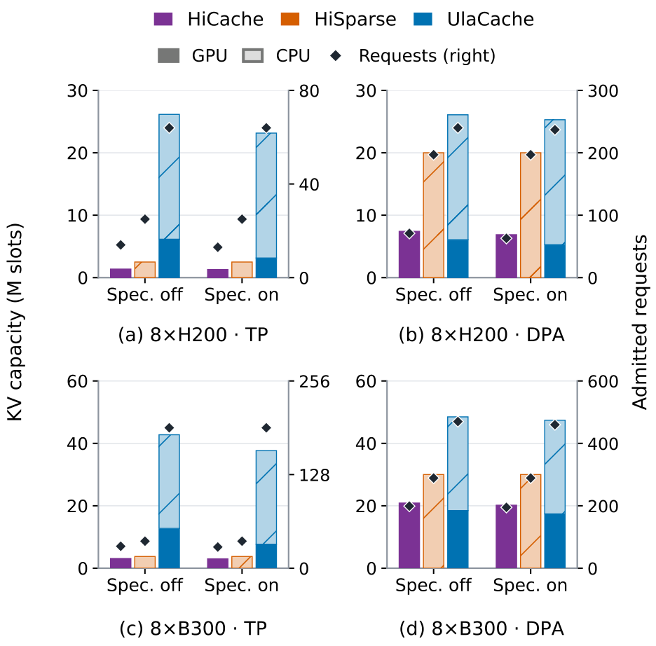
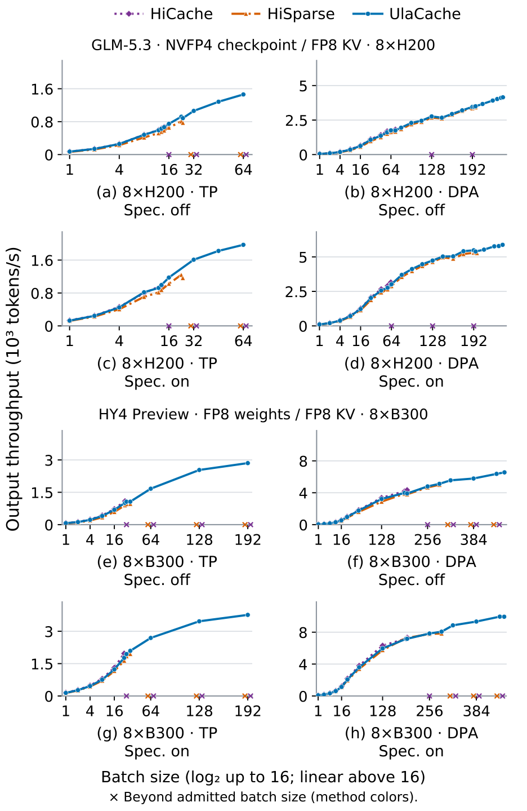

# UlaCache

Source repository: https://github.com/scitix/UlaCache

UlaCache pools GPU and CPU memory for sparse-attention KV caches. It supports
prefetching, distributed Index storage, and prefix-cache reuse through SGLang,
with TP, DPA, and context-parallel execution on NVIDIA H200 and B300 GPUs.

## Paper

[UlaCache: Unified Logical Addressing for Sparse LLM Serving](https://arxiv.org/abs/2610.29820)
is available on arXiv. [Read the PDF](https://arxiv.org/pdf/2610.29820).

## Results

The figures below summarize the updated manuscript. The comparisons use
GLM-5.3 NVFP4 on eight H200 GPUs and Hy4 Preview FP8 on eight B300 GPUs.

### KV capacity

Under matched memory budgets, UlaCache provides up to **11.4 times the usable
KV cache capacity of HiSparse** with tensor-parallel attention (TP). The figure
compares GPU and CPU KV capacity and the number of admitted requests.



### Throughput scaling

UlaCache's larger KV capacity supports higher decoding concurrency and extends
throughput scaling. With speculative decoding enabled in both systems, its
peak decoding throughput relative to HiSparse is:

| Model and platform | Data-parallel attention (DPA) | Tensor-parallel attention (TP) |
| --- | ---: | ---: |
| GLM-5.3 NVFP4, 8 × H200 | 1.10× | 1.59× |
| Hy4 Preview FP8, 8 × B300 | 1.27× | 1.93× |



## Installation

Use Linux with NVIDIA GPUs and the public SGLang v0.5.22 image:

```bash
docker run --gpus all --ipc=host --rm -it \
  -v "$PWD":/workspace/ulacache -w /workspace/ulacache \
  lmsysorg/sglang:v0.5.22 bash
```

Inside the container:

```bash
python scripts/validation/install.py --verify-cuda
```

The installer applies `patches/sglang.patch`, installs UlaCache, and verifies
installed imports and CUDA availability. The patch targets SGLang commit
`baa9befa381511cd4d56f83980951e5a45fffc6d`.
Use `--sglang-root /path/to/sglang` to select a different checkout of that commit.

## Usage

Choose a model configuration from [scripts/configs/models](scripts/configs/models)
and adjust its memory and request limits for your deployment:

```bash
export ULACACHE_CONFIGURATION=/path/to/configuration.json
python -m sglang.srt.ulacache.entry \
  --model-path /path/to/model --tp-size 8 --kv-cache-dtype fp8_e4m3
```

The cache API follows `init`, `alloc`, `write`, `access`, and `free`.
SGLang retains responsibility for request scheduling, prefix matching,
attention, and sampling.

## Experiments

[scripts/README.md](scripts/README.md) describes the launch commands and
measurement protocols. Each numbered directory provides separate launchers
for UlaCache, HiSparse, and the baseline:

| Directory | Experiment |
| --- | --- |
| `scripts/7_1_online` | Multi-turn serving |
| `scripts/7_2_throughput` | Decode throughput |
| `scripts/7_3_low_latency` | Low-batch latency and context parallelism |
| `scripts/7_4_capacity` | KV capacity |
| `scripts/7_5_scheduler` | Scheduler ablation |
| `scripts/7_6_indexer` | Distributed Index ablation |

Workload manifests, replay traces, and raw experiment outputs are distributed
separately. See [dataset preparation](scripts/datasets/README.md) for input formats.

## Source layout

```text
ulacache/
  cache/       Allocation, residency, and cache lifecycle
  storage/     KV layouts and memory pools
  eviction/    Replacement policies
  transfer/    Prefetch and GPU/CPU transfers
  indexer/     Distributed Index storage and scoring
  flashag/     GPU communication
  csrc/        C++ and CUDA kernels
scripts/       Launchers, benchmarks, and validation
patches/       Framework integration patches
```

## Validation

```bash
python -m pip install -e '.[test,artifact]'
python -m pytest -q
python scripts/validation/check.py
```

## AI assistance and maintenance

Most of the code in this repository was generated using AI tools. We have
checked the reported results and will continue updating and improving the code.

We welcome you to try UlaCache and share feedback. Please
[open an issue](https://github.com/scitix/UlaCache/issues) to report bugs or
unexpected behavior. Pull requests with bug fixes and improvements are welcome.

## License

Apache-2.0. See [LICENSE](LICENSE) and [NOTICE](NOTICE) for third-party attribution.
